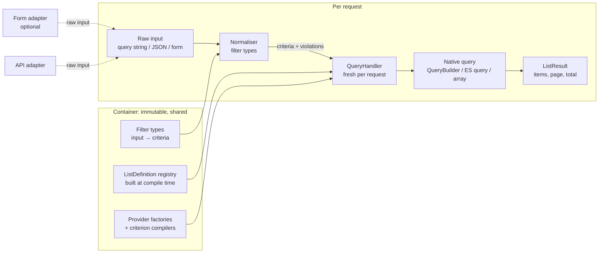

# Sidus/FilterBundle 7.0: design

Status: proposal, pending the owner's answers to section 15. Branch `v7.x` (forked from `v6.x` at v6.0.4).
Facts are labelled **[read]** (source or history read), **[verified]** (executed, mostly in
`filter-bundle-review.md`), or **[inference]**.

## 0. Goals and non-goals

Goals, in priority order:

1. **Request isolation by construction.** The container holds only immutable, request-agnostic objects.
   Everything that holds a query, sort state, page, form or join map is created per request and never stored in a
   service.
2. **One configuration, any data source.** A list definition (filters, sorting, pagination, count) means the same thing
   on Doctrine ORM, EAV, an in-memory array, a remote API or Elasticsearch. Where a data source cannot honour that
   meaning, the difference is explicit: either a configuration error or a documented, listed approximation.
3. **Symfony Forms are optional.** The core takes a plain array of input (query string or JSON body) and returns a
   result page. HTML forms are an adapter on top of it.
4. **Fail early.** Misconfiguration fails at container compile time (structure, types, capabilities) or at cache warm-up
   (attribute paths against Doctrine metadata), never on the first visitor's request.
5. **Deterministic native queries.** Same input shape gives the same DQL and the same parameter names, so Doctrine's
   query cache hits.

Non-goals for 7.0: GraphQL, cursor (keyset) pagination, full-text relevance scoring, an admin UI.

## 1. What history says (archaeology)

### 1.1 Join reuse

What this repository did, in order **[read]** (`git log -S uniqid`, `-G 'leftJoin\('`, `git show`):

| Commit | Date / first tag | Behaviour |
|---|---|---|
| `17aaa5a`, `185506f` | 2017 | Attributes with a dot were used verbatim as DQL (`author.name`): the consumer had to create the join and its alias himself, so "reuse" meant "every filter reuses the consumer's one join". |
| `e5b2942` "Fixing nested doctrine attributes" | 2018-08-03, v2.0.0 | `getFullAttributeReferences()` walks the path and adds `$qb->join($previous, uniqid('nested'))` per segment: **one fresh INNER JOIN per attribute reference**. |
| `de04c2e` "Fixing sort column alias resolving" | 2018-08-08 | Same logic moved to `DoctrineQueryHandler::resolveAttributeAlias()`, also used by the sort. |
| `e6e5630` / `1c590ad` "Using left join instead of inner join when resolving nested attributes" | 2020-04, v3.0.x | INNER JOIN replaced by LEFT JOIN (the inner join silently removed rows whose relation is null, including for the sort). |
| `d0fa29c` "Fixing choice SQL join issue properly" | 2020-04-20 | `ChoiceFilterType` clones the builder to undo the joins it creates while computing choices. |
| `7bba1e2` / `c8014f9` / `c3eb5c7` | 2021-2023 | Resolution moved to metadata-driven `getAttributeMetadata()` (then `DoctrineAttributeMetadataResolver`), join type made a parameter, `uniqid('nested'.ucfirst($attribute))` kept. |

There never was a memoised join in **this** repository. The "reuse caused issues" experience is in
`Sidus/EAVModelBundle` **[read]** (cloned in `/tmp/eavgit`):

- `176a8d8` (2017-04-27, v1.2.0) "Fixed EAV query builder: same join could be applied multiple times in certain
  conditions": `AttributeQueryBuilder` gets `$joinApplied`, each *attribute query builder* (one condition) owns its own
  join alias (`generateUniqueId`) and applies it once.
- `71d08f9` (2017-08) "Allowing join on attributes": relation joins through `join($alias = null)`, unique alias by
  default.

Why a per-condition join is the right default in EAV and on any to-many path **[inference, standard SQL semantics]**:
values live in a to-many table. "`tags` contains `a`" AND "`tags` contains `b`" means
*∃v₁: v₁ = a* ∧ *∃v₂: v₂ = b*. If both conditions share one join alias it becomes *∃v: v = a ∧ v = b*, which is always
empty. Sharing a join across *independent* criteria on a to-many path changes the meaning of the query. On a to-one
path sharing is always safe (there is at most one related row). The keres-platform `GamePlayerFilterType`
**[read]** documents the other face of the problem: a LEFT JOIN on a to-many collection "multipl[ies] rows (and
break[s] pagination counts)", so it uses an `EXISTS` subquery instead.

What the fresh-join behaviour protected, therefore: (a) independent criteria on to-many paths keep "any element
matches" semantics; (b) one filter cannot alter another filter's join (no shared `WITH` condition, no join-type
clash); (c) a consumer's own joins and aliases are never hijacked. What it costs: random aliases (query-cache miss on
every request, **[verified]** in the review), duplicated joins on to-one paths, and row multiplication on to-many paths
that forces the Paginator's three-query DISTINCT mode.

### 1.2 Pending filter types

`NotEmptyFilterType`, `NullFilterType`, `RegexpFilterType` are not in this repository's history (`git log --all` on
the names: only `NotNullFilterType`, added in `0214a43`) **[read]**. They exist in
`~/www/archives/qk-sds-api/src/Quarks/SdsAnalysis/AdminBundle/Filter/Type/` **[read]**:

- `NullFilterType`: `{column} IS NULL` when the checkbox is set (registered as `is_null` in `Line.yaml`).
- `NotEmptyFilterType`: calls `getAttributeMetadata($path, Join::INNER_JOIN)` and adds no WHERE at all: "not empty"
  is obtained as a side effect of an INNER JOIN, for relations only, always on (ignores `$data`).
- `RegexpFilterType`: combo `regexp|not_regexp|iregexp|not_iregexp` compiled to custom DQL functions `REGEXP`,
  `NOT_REGEXP`, `IREGEXP`, `NOT_IREGEXP` (PostgreSQL `~`, `!~`, through `martin-georgiev/postgresql-for-doctrine`
  `BaseFunction`).

### 1.3 The reference handler (`qk-sds-api` `DoctrineQueryHandler`) **[read]**

It extends the bundle's handler and adds:

1. **Named, reusable joins** declared in `options.joins` (key = entity class, `alias`, then either
   `reference: <field>` meaning `alias.field = e`, or `condition: [field, path]` meaning `alias.field = <resolved path>`,
   resolved recursively). A join is applied once per handler (`$appliedJoins`) on first use by any attribute starting
   with `<alias>.`. This joins **unrelated entities** (no Doctrine association), which the metadata resolver cannot do.
2. **JSON paths and casts in attribute strings**: `totals->regression::int` becomes
   `CAST(JSON_GET_FIELD(e.totals, 'regression') AS int)`, usable by any filter type and by the sort.
3. **Computed sort columns**: `statistics_<property>` columns become hidden SELECT expressions (ratio with
   `NULLIF`, empty-last flag, tie-breaker), i.e. a sort on an expression rather than on a field.
4. Pager switches `allowOutOfRangePages` and `fetchJoinCollection` (public mutable properties).

Better than the bundle: joins are deterministic and shared by name; unrelated entities are reachable; JSON documents
are first-class; sort can target an expression. Weak points: it is a fork (overrides of protected internals), the
join map is handler state (correct only because ComTSo-style per-request handlers are not used there either
**[inference]**), the JSON/cast syntax is parsed at request time and `::type` goes into DQL unvalidated (config-trusted
only), a shared named join on a to-many target multiplies rows silently, and the computed sort is hard-coded to one
entity class.

### 1.4 Existing providers (the real SPI requirements) **[read]**

| Provider | Where | What its handler needs |
|---|---|---|
| `doctrine` | this bundle | QueryBuilder, metadata resolver, Doctrine Paginator |
| `sidus.eav` (EAV) | `github.com/VincentChalnot/SidusEAVFilterBundle` (cloned `/tmp/eavf`, last commit 2019) | extends the Doctrine handler; adds a root condition (`family`), its own attribute resolution (attribute codes, `allowed_families` for nesting), per-condition joins, **a hydrating data loader on the result page** (`EAVAdapter` + `DataLoaderInterface`, `loader_depth`), query/result *contexts* |
| `sidus.elastica` | `github.com/VincentChalnot/SidusElasticaFilterBundle` (last commit 2018) | a `BoolQuery` root, filters add `must` clauses (`Wildcard('*x*')` for text, `Term` for choice), **pager and total from the search engine** (`findPaginated`) |
| `in_memory` | `qk-sds-api` `LogAnalyserBundle` | an array of objects/arrays, PropertyAccessor reads, `ArrayAdapter`. Contains a real bug: `applySort()` sorts `$this->data` after `applyFilters()` copied it into `$filteredData`, so the page is never sorted **[inference from code]**. |
| remote API | not found on this machine (`sidus/api-client-bundle` exists in `qk-sds-api/vendor` without a filter provider) | owner's description only: criteria mapped to query parameters, total from the response |

Nothing else on the machine implements `QueryHandlerFactoryInterface` (grep across `~/www`).
Custom filter types in apps: ComTSo `AdminRoleFilterType`, keres-platform `GamePlayerFilterType` (EXISTS subquery),
qk-sds-api `HashFilter` (bytea/hex), `SdsFileTextFilter` (fixed joins), `WorkspaceFilterType` (security-dependent
default). The new design must keep a native escape hatch for all of them.

## 2. Architecture overview



Two layers, strictly separated:

- **Filter type** (user-facing): validates and normalises one filter's raw input and emits abstract **criteria**. It
  knows nothing about data sources and nothing about Symfony Forms.
- **Criterion compiler** (data-source-facing): per provider and per criterion class, realises a criterion in the
  native query. Each provider publishes a **capability table** of what it supports and how.

This replaces `FilterTypeInterface::handleData(QueryHandlerInterface, FilterInterface, $data)` that mixed both
layers and forced one filter type per (provider, name) pair (eight Doctrine filter types, re-implemented by each
provider).

## 3. Packages and namespaces

Recommendation: **one Composer package, `sidus/filter-bundle` 7.0, with hard namespace boundaries**, plus a separate
package for Elasticsearch later. Rationale: one owner, a small codebase, and providers that are all his; a monorepo
split costs a release pipeline (subtree split, synchronized tags) for no current consumer benefit. Boundaries are
enforced by a test (no `use` of Doctrine/Form/Pagerfanta classes outside their namespace), so a later split is a
mechanical move.

```
src/                                 PSR-4 Sidus\FilterBundle\ (moved from the repository root; Tests/ stays out of the dist)
  Contract/                          interfaces + value objects; depends on nothing
    Criterion/                       Criterion vocabulary (section 4)
    Definition/                      ListDefinition, FilterDefinition, SortDefinition, ... (readonly)
    Input/                           ListInput, Violation, ViolationList
    Result/                          ListResult, Page
    Provider/                        QueryHandlerFactoryInterface, QueryHandlerInterface, CriterionCompilerInterface,
                                     Capabilities, Support, CountStrategyInterface
    Filter/                          FilterTypeInterface
  Core/                              provider-agnostic implementation
    Filter/Type/                     built-in filter types (text, choice, number, date_range, null, not_empty, regexp, sort, ...)
    Registry/                        ListDefinitionRegistry, QueryHandlerRegistry, FilterTypeRegistry
    Handler/                         AbstractQueryHandler (pipeline), InputNormaliser
  Provider/
    InMemory/                        reference provider (arrays/objects), executable semantics
    Doctrine/                        Doctrine ORM provider (requires doctrine/orm, suggested)
  Bridge/
    Form/                            Symfony Form adapter, form themes (requires symfony/form, suggested)
    Pagerfanta/                      ListResult → Pagerfanta adapter (requires pagerfanta/core, suggested)
    HttpFoundation/                  Request → ListInput, ListResult → JsonResponse payload
  Bundle/                            SidusFilterBundle (AbstractBundle), configuration tree, compiler passes, commands
```

Composer `require`: `php ^8.4`, `symfony/config`, `symfony/dependency-injection`, `symfony/http-kernel`,
`symfony/property-access` (in-memory provider), `symfony/options-resolver`. `suggest`/`require-dev`: `doctrine/orm ^3.3`,
`doctrine/doctrine-bundle`, `symfony/form`, `symfony/twig-bridge`, `pagerfanta/core`, `symfony/http-foundation`.
Every optional integration is registered only when its classes exist (`class_exists`/`ContainerBuilder::willBeAvailable`).

External packages: `sidus/eav-filter-bundle` 3.0 builds on `Provider/Doctrine` (it is a Doctrine dialect: same
compilers, its own field resolver and result hydrator); `sidus/elastica-filter-bundle` (or a new
`sidus/filter-elasticsearch`) depends on `Contract` + `Core` only; a remote-API provider likewise.

## 4. Criterion vocabulary

A **field** is a logical attribute path from the list definition (`title`, `author.name`, `tags`, `totals.regression`),
resolved per provider (section 8). A **criterion** is an immutable value object; the vocabulary is closed in the core
and extensible by provider packages (a new criterion class plus its compilers).

| Criterion | Meaning (reference semantics = in-memory provider) |
|---|---|
| `Equals(field, value)` | value is strictly equal after type normalisation (strings case-sensitive, dates compared as instants, numbers numerically). |
| `In(field, values)` | `Equals` for any of the values. Empty list is rejected at normalisation (never "match nothing"). |
| `Contains(field, text, caseSensitive=false)` | substring match. Wildcards in `text` are literal (`%`, `_`, `*` escaped). Case folding is Unicode lower-case (`mb_strtolower`); accent folding is **not** part of the meaning. |
| `StartsWith`, `EndsWith` | same rules as `Contains`, anchored. |
| `Range(field, min?, max?, minInclusive=true, maxInclusive=true)` | ordered comparison for numbers and dates; covers `>`, `>=`, `<`, `<=` and date ranges. A date-only upper bound means end of that day (normalised by the date filter type, not by providers). |
| `IsNull(field)` | value is null or the property is absent. For a to-one relation: no related entity. |
| `IsEmpty(field)` | null, empty string, or empty collection. `NotEmpty` = `Not(IsEmpty)`. |
| `Matches(field, pattern, caseSensitive=true)` | POSIX ERE subset (documented: `.`, `[]`, `*`, `+`, `?`, `{m,n}`, `^`, `$`, `|`, groups; no backreferences, no lookaround) so it means the same in PCRE, PostgreSQL, MySQL 8 ICU and Elasticsearch (the latter is anchored: compiler adds `.*` where needed). |
| `Not(criterion)`, `AnyOf(criteria)`, `AllOf(criteria)` | boolean composition. A filter with several attributes emits `AnyOf` over them (current OR behaviour). |
| `Native(provider, payload)` | escape hatch: provider-specific, opaque to other providers (section 6). |

Rules common to every criterion:

- **To-many fields mean "any element"**: `Contains(tags.label, 'x')` is true if at least one tag's label contains `x`.
  Two criteria on the same to-many path are independent (each has its own "any"). This is the EAV-proven semantic of
  section 1.1, now written down and tested.
- **Null never matches a comparison** (`Equals`, `Contains`, `Range`, `Matches` are false on null), like SQL three-valued
  logic collapsed to false, so `Not(Contains(x))` is true for null. Arrays, SQL and ES all get this right only if
  compilers are written for it, hence contract tests (section 13) cover nulls explicitly.

Sorting and pagination use two more value objects, not criteria (they do not change set membership): `OrderBy(field,
direction, nulls=last)` (list, stable: the provider appends the identifier as tie-breaker) and `Page(number, size)`.

## 5. Filter types (user-facing layer)

```php
interface FilterTypeInterface
{
    public static function getName(): string;                           // 'text', 'choice', ...

    /** Validate the filter's own options at compile time (OptionsResolver). */
    public function configureOptions(OptionsResolver $resolver): void;

    /** Operations this filter can emit for this definition: used for capability checks at compile time. */
    public function getRequiredOperations(FilterDefinition $filter): array; // list<class-string<Criterion>>

    /** Raw input (string/array from query, JSON, form, or configured default) → normalised value or violations. */
    public function normalize(FilterDefinition $filter, mixed $raw): NormalizedValue;   // value|empty|violations

    /** Normalised value → criterion (null when the filter is inactive). */
    public function buildCriterion(FilterDefinition $filter, mixed $value): ?Criterion;
}
```

Filter types are provider-independent, registered once by name (no more `[provider][name]` matrix). Built-in types:

| Type | Input | Emits | Replaces (v6) |
|---|---|---|---|
| `text` | string, or `{operator, value}` when `options.operators` lists several | `Contains` (default), `StartsWith`, `EndsWith`, `Equals`, `Not(..)`, `IsNull`, `IsEmpty` | `text`, `advanced_text` |
| `exact` | scalar | `Equals` | `exact` |
| `choice` | scalar or list; choices from `options.choices` or from the provider's distinct values | `Equals` / `In` | `choice`, `custom_choice` |
| `relation` | identifier(s) | `In(field.id, ids)` | `entity` |
| `number` | number, or `{operator, value}` | `Equals`, `Range`, `IsNull` | `advanced_number` |
| `date_range` | `{from, to}` (ISO 8601 strings or DateTimeInterface) | `Range` | `date_range` |
| `null` / `not_null` | boolean flag | `IsNull` / `Not(IsNull)` | `not_null`, qk `NullFilterType` |
| `not_empty` | boolean flag | `Not(IsEmpty)` | qk `NotEmptyFilterType` (now an explicit criterion, not an INNER JOIN side effect) |
| `regexp` | `{operator: matches|not_matches|imatches|not_imatches, value}` | `Matches` / `Not(Matches)` | qk `RegexpFilterType` |
| `sort` | see section 9 | `OrderBy[]` | `SortConfig`, `sortable`, `default_sort` |
| `native` | anything | `Native` built by a callable service | `handleData` overrides |

What is kept from v6: the *filter* (named, configured, with `attributes`, `default`, `label`, `options`), the
multi-attribute OR, the type registry autoconfigured by interface. What is cut: `handleData(QueryHandlerInterface,...)`,
`getFormType()`/`getFormOptions()` on the filter type (moved to the form adapter), the provider dimension of filter
types, the `BadQueryHandlerException` type checks. Combo option codes (`_like_`, `notlike_`, `greaterthanequals`) are
replaced by operator names (`contains`, `not_starts_with`, `gte`); translation keys follow.

Custom filter types written for an app (ComTSo `AdminRoleFilterType`, keres `GamePlayerFilterType`) either compose
core criteria (`AnyOf(Contains(players.user.username), Contains(players.user.email), ...)`, which the Doctrine provider
compiles to one `EXISTS` per to-many path, i.e. exactly what `GamePlayerFilterType` writes by hand) or emit `Native`.

## 6. Capability negotiation and vendor-specific realisation

Each provider factory publishes a `Capabilities` table: criterion class → `Support`:

- `Support::native()`: faithful realisation of the reference meaning.
- `Support::approximate(string $note)`: realised with a documented difference (example: Elasticsearch `Contains` on an
  analysed `text` field via `match_phrase` matches token sequences, not substrings).
- `Support::unsupported(string $reason)`.

Support can depend on the field (`supportsField(criterion, ResolvedField)`): `Matches` on Doctrine is native only if
a `REGEXP`-family DQL function is registered; on ES `Contains` is native on `keyword`/`wildcard` fields and
approximate on `text`.

Resolution, per filter, at compile time (structure) and at warm-up (field-dependent checks):

1. The filter type lists the criteria it can emit for this definition (`getRequiredOperations`).
2. For each, the provider's table answers. `unsupported` → **configuration error** naming the list, filter, criterion
   and reason. `approximate` → allowed, reported by `bin/console debug:sidus-filter <list>` and logged once at warm-up;
   a global `strict_semantics: true` turns approximations into errors.
3. **Explicit opt-out**: a filter may narrow its own operators (`operators: [contains, starts_with]`) so an unsupported
   one is never emitted; there is no "silently skip a filter at runtime" mode.

Vendor-specific overrides live **per filter, under the provider's name**, and are validated by that provider
(each factory contributes a config sub-tree):

```yaml
filters:
    title:
        type: text
        provider_options:
            elasticsearch: { strategy: match_phrase_prefix, field: title.raw }   # ignored by other providers
            doctrine: { case_insensitive: lower }   # 'lower' (LOWER() both sides, default) | 'ilike' (custom function) | 'collation'
```

Compilers are services tagged `sidus_filter.criterion_compiler` with `provider` and `criterion` attributes
(autoconfigured through a PHP attribute `#[AsCriterionCompiler(provider: 'doctrine', criterion: Contains::class)]`),
indexed by the provider factory itself in its constructor (iterable + read the attribute values), not through a
`defaultIndexMethod` locator. An app or a provider package can add a compiler for a new criterion or decorate an
existing one; `provider_options.<provider>.strategy` selects among several registered strategies.

## 7. Configuration

### 7.1 Format

```yaml
sidus_filter:
    strict_semantics: false
    lists:                                   # was: configurations
        posts:
            provider: doctrine
            options: { entity: App\Entity\Post }   # provider-validated
            pagination: { per_page: 15, max_per_page: 100 }   # was: results_per_page
            count: { strategy: auto }               # auto | none | <service id>; section 10
            fields:                                 # optional public names for paths (API contract)
                author: author.name
            filters:
                title: { type: text, operators: [contains, starts_with, equals] }
                author: { type: text, attributes: [author.name, author.email] }
                published: { type: date_range, attributes: [publishedAt] }
                tags: { type: relation }
                status: { type: choice, options: { choices: { draft: draft, published: published } }, default: published, locked: true }
                sort:
                    type: sort
                    options:
                        columns: { title: title, date: publishedAt, author: author.name }   # public key → field
                        default: [ { column: date, direction: desc } ]
```

`label` and `form_type`/`form_options` move to a `form:` sub-key read only by the form adapter. `hidden` becomes
`locked: true` (value fixed by configuration, never read from input, still normalised through the same filter type:
fixes v6 hidden filters bypassing transformers).

### 7.2 Compilation

The extension processes the tree, then a compiler pass (after all providers and filter types are registered) builds
every `ListDefinition` value object (readonly classes, no setters, no back-references), runs filter-type option
resolution and the capability checks of section 6, and passes the definitions to `ListDefinitionRegistry` as a plain
constructor argument (scalars/arrays, rebuilt into objects once and memoised; they are immutable, so the memo is safe).
Field resolution that needs runtime services (Doctrine metadata) runs in a cache warmer and in
`bin/console lint:sidus-filter`, so `cache:warmup` (and therefore deploy and CI) fails on a bad path.

### 7.3 Old → new mapping (upgrade note)

| v6 | v7 |
|---|---|
| `sidus_filter.configurations.<code>` | `sidus_filter.lists.<code>` |
| `results_per_page: 15` | `pagination.per_page: 15` |
| `sortable: [a, b.c]` + `default_sort: {a: desc}` | accepted as shorthand, expanded into a `sort` filter with `columns: {a: a, b.c: b.c}` |
| `type: advanced_text` | `type: text` with `operators: [...]` (all operators by default for the old name) |
| `type: advanced_number` | `type: number` |
| `type: custom_choice` / `choice` | `type: choice` |
| `type: entity` | `type: relation` |
| `options.hidden: true` | `locked: true` |
| `label`, `form_type`, `form_options` | `form: { label, type, options }` |
| `default:` | unchanged, normalised like user input |
| qk `options.joins` | `options.joins` (section 8.3, renamed keys) |
| qk `totals->regression::int` | unchanged shorthand, or `{ path: totals, json: [regression], cast: integer }` |

## 8. Doctrine provider

### 8.1 Field resolution

A `ResolvedField` (immutable, memoised per list) is computed from metadata once: list of segments, each
association typed `to_one`/`to_many`, terminal field type, optional JSON path and cast. Unknown segment,
scalar-in-the-middle, or a cast outside the allow-list (`integer`, `float`, `string`, `boolean`, `date`) is a warm-up
error. No request input is ever resolved: sort columns and filter attributes all come from configuration.

### 8.2 Join strategy

Per request, a `JoinRegistry` inside the `DoctrineQueryContext` (the per-request query object, not a service):

- **To-one path prefixes are shared**: one `LEFT JOIN` per distinct prefix, aliases derived from the path
  (`author` → `author_`, `author.company` → `author_company_`, numeric suffix on collision, in deterministic
  definition order). Safe because a to-one join never changes cardinality nor the meaning of other criteria.
- **To-many paths compile to correlated `EXISTS` subqueries per criterion**, with their own aliases (`x1_tags`,
  numbering by criterion position). This preserves the per-criterion "any element" semantics the EAV bundle and the
  fresh joins protected, never multiplies rows, and lets pagination use a plain `LIMIT/OFFSET` with a cheap count.
- **Sorting on a to-many path** is a configuration error unless the column declares an aggregate
  (`{field: comments, aggregate: count|min|max}`), compiled as a hidden select.
- **Join type**: always LEFT for shared to-one joins (an inner join would filter rows for the sort too: what
  `e6e5630` fixed). Criteria in WHERE give inner semantics when they need it.
- **Parameters** are named `p1`, `p2`, ... in compilation order (definition order of active filters). DQL varies only
  with *which* filters are active, a finite set of shapes → query-cache hits. Test: identical input twice gives
  byte-identical DQL; differing values give identical DQL.
- **Opt-in shared to-many**: `provider_options.doctrine.join: shared` on a filter, or the same *named join*
  (8.3) used by several filters, gives "the same element satisfies all of them" semantics deliberately; the list then
  switches its default count and fetch to the DISTINCT mode, which is reported by `debug:sidus-filter`.

### 8.3 Named joins and JSON paths (port of the qk-sds-api handler)

```yaml
options:
    entity: Quarks\...\Line
    joins:
        language:                                     # alias, usable as a path root: language.language
            entity: Quarks\...\SdsFileLanguage
            on: { field: sdsFile, equals: page.pages.sdsFile }   # alias.sdsFile = <resolved path>
            cardinality: one                          # one | many: many makes it behave like a to-many path
```

A named join is added once per request on first use (shared scope by declaration), its `equals` path is resolved with
the same rules (so it may itself use shared to-one joins), and it is validated at warm-up. `cardinality: many` names
are compiled like to-many paths (EXISTS) unless `shared: true`.

JSON: `{ path: totals, json: [regression], cast: integer }` (or the `totals->regression::int` shorthand, parsed at
compile time). Compilation goes through a `JsonPathCompilerInterface` service; the shipped one targets the
`martin-georgiev/postgresql-for-doctrine` functions used by qk-sds-api (`JSON_GET_FIELD`, `JSON_GET_FIELD_AS_TEXT`,
`JSON_GET_FIELD_AS_INTEGER`); a JSON field without a registered compiler is a warm-up error. The in-memory provider
reads JSON paths as nested array keys and Elasticsearch as object sub-fields, so the same path means the same thing
on all three.

Expression sort columns (qk's computed statistics) become a `sort` column with
`provider_options.doctrine.expression: '...{root}...'`, allow-listed by construction because it lives in
configuration.

### 8.4 Consumer extension point

ComTSo's `prepareQuery()` hooks add joins/selects between `buildForm()` and `handleRequest()`. v7 makes it explicit:

```php
$handler = $registry->createQueryHandler('topics');
$result = $handler
    ->withCustomizer(static fn (DoctrineQueryContext $q) => $q->queryBuilder()->addSelect(...)->leftJoin(...))
    ->handle($input);
```

Customizers run on the freshly created builder before criteria are applied; they get the root alias and the
`JoinRegistry` (to reuse a shared to-one alias instead of adding their own). The builder is never returned to the
consumer outside a customizer, so there is no ordering trap.

## 9. Sorting as a filter

The `sort` filter type takes `sort=-date,title` (API), `sort[]=date:desc` or the form adapter's structure, and emits
`OrderBy[]`. Its `columns` option maps **public keys** to fields: the input names a key, never a property path, so the
allow-list is structural (`author.password` is not a key, therefore cannot be requested). Unknown key, malformed
direction, or more than `max_columns` → violations (section 11). The provider appends the identifier as final
tie-breaker (stable pages). `default` applies when the input has no valid sort. Top-level `sortable`/`default_sort`
remain as shorthand (7.3).

## 10. Count strategy

```php
interface CountStrategyInterface
{
    public function count(QueryContextInterface $query, ListDefinition $list, ListInput $input): ?int; // null = unknown
}
```

- `auto` (default): the provider's native count. Doctrine: `SELECT COUNT(root.id)` on a clone without ORDER BY and
  without fetch joins (with EXISTS for to-many there is no duplication; DISTINCT mode only when a shared to-many join
  exists). In-memory: `count()`. Elasticsearch: `hits.total` with `track_total_hits` (approximate above the configured
  threshold, flagged in the result).
- `none`: no total (result exposes `hasNextPage` by fetching `size + 1`), for APIs on huge tables.
- A **service id**: any `CountStrategyInterface` (cached counts, a dedicated optimised query; replaces
  `ManualCountAdapterInterface` users).
- **Per request**: `$input->withTotalCount(int)` or `->withTotalCount(fn () => $cache->get(...))` (lazy). This is the
  first-class version of `setNbResults()`.

The total is computed lazily (only if the result's `total()` is read) and once.

## 11. Request lifecycle and input errors

```php
$handler = $queryHandlerRegistry->createQueryHandler('posts');   // new object every call; never cached
$result  = $handler->handle(ListInput::fromArray($request->query->all()));   // single use: second handle() throws
$result->items(); $result->page(); $result->perPage(); $result->total(); $result->violations(); $result->state();
```

`ListInput` is `{filters: array<code, raw>, sort: raw, page: raw, per_page: raw}`. Normalisation never throws on user
input: each invalid part becomes a `Violation` (path, message, invalid value) and that part falls back to its default
(page 1, default sort, filter inactive). The violations travel in the result; adapters decide:

- API (`Bridge/HttpFoundation`): `strict` by default → 400 with the violation list.
- HTML (form adapter): violations mapped to form errors, page rendered with defaults for invalid parts.

`$result->state()` is the normalised, applied state (what the form adapter renders back and what an API echoes).

Registry public API: `createQueryHandler(string $code): QueryHandlerInterface`, `getDefinition(string $code):
ListDefinition`, `has(string $code): bool`. No `add*` methods: definitions come only from configuration (DataGrid
registers its inline query handlers through a documented container tag/extension prepend at compile time, section 14).

## 12. Optional adapters

### 12.1 Symfony Form

`Bridge/Form/ListFormFactory::create(ListDefinition, ?ListState): FormInterface` builds a GET form: one child per
non-locked filter, mapped by a `FormFilterMapperInterface` registered **per filter type name** (provider-independent;
the Doctrine bridge adds the mapper for `relation` → `EntityType` with the resolved target class and a choice loader
limited to related ids, without touching the main query). The form's submitted data is converted back to *raw input*
and goes through the same normaliser as an API call; the form never applies anything to a query.
Sort UI: a `sort` child with one button per column key plus the current state, rendered by `sidus_filter_sort_*` blocks
(DataGrid header cells use `form.sort.<key>` instead of `formView.sortable[index]`). Global `DateExtension` and
`DoctrineEntityExtension` are removed: string defaults are handled by the normalisers. Themes: base + Bootstrap 5
(pending question 6).

### 12.2 API endpoint

`Bridge/HttpFoundation/ListRequestParser` (query string `filters[title]=x&sort=-date&page=2&per_page=50`, or the same
structure as a JSON body) and `ListResultNormalizer` producing
`{items, page, per_page, total, pages, sort, filters, violations}` (`items` serialised by the app's serializer and
groups). An `ArgumentValueResolver` for `ListInput` and an optional generic controller are thin helpers on top.

### 12.3 Pagerfanta

`Bridge/Pagerfanta/ListResultAdapter` exposes a `ListResult` as a Pagerfanta adapter (DataGrid templates keep
`pager`-based pagination).

## 13. Testing strategy

Run in Docker (local PHP lacks `pdo_sqlite`): `docker run --rm -v $PWD:/app -w /app comtso-php-dev composer test`
(PHP 8.5, pdo_sqlite, pdo_pgsql). PHPUnit 12.

1. **Worker-mode test** (first, red on v6 code): micro-kernel with SQLite, one booted kernel, three requests through
   the same container; asserts no exception, no leaked filter, single ORDER BY, stable DQL. Plus two handlers for one
   code inside one request.
2. **Unit tests** per filter type (normalisation, violations, emitted criteria) and per value object.
3. **Shared contract suite** (`Tests/Contract/`): one fixture dataset (posts, authors, to-many tags, nulls, empty
   strings, mixed case, Unicode, equal sort keys) defined once as PHP arrays and loaded into each provider (array of
   objects, SQLite schema through Doctrine). Cases are data: `[list definition, input, expected ordered ids, expected
   total, expected violations]`. `AbstractProviderContractTestCase` runs every case; `InMemoryProviderTest` is the
   reference, `DoctrineSqliteProviderTest` second, `DoctrinePostgresProviderTest` when `SIDUS_FILTER_PG_DSN` is set,
   Elasticsearch in its own package with the same suite class.
4. **Divergences are data too**: each provider test declares `knownDivergences(): array<caseId, reason>` (for example
   SQLite `LOWER()` is ASCII-only, so Unicode case folding diverges). The suite asserts that a declared divergence
   *does* diverge, so the list cannot rot, and `docs/divergences.md` is generated from it.
5. **Doctrine-specific**: DQL determinism, one join per to-one prefix, EXISTS per to-many criterion, count query shape,
   named joins, JSON paths (PostgreSQL only).
6. **Container**: compiles with zero deprecations under Symfony 7.4 and 8.x, misconfigurations fail at compile/warm-up
   with the intended messages, layering test (no Doctrine/Form imports outside their namespaces).
7. CI: GitHub Actions matrix PHP 8.4/8.5 × Symfony 7.4/8.x, lowest/highest dependencies, PostgreSQL service.

## 14. Migration

**SidusDataGridBundle (5.0, owner's change; this bundle does not edit it):**

- `DataGridRegistry` keeps configurations only and builds a new `DataGrid` per `getDataGrid()` call; the `DataGrid`
  gets a fresh handler from `QueryHandlerRegistry::createQueryHandler()`.
- Inline `query_handler` blocks: `SidusDataGridExtension::prepend()` appends them to `sidus_filter.lists` as
  `__sidus_datagrid.<code>` (remove the runtime `addRawQueryHandlerConfiguration`).
- `DataGrid::buildForm()/handleRequest()` → `ListFormFactory::create()` + `$handler->handle(ListInput)`;
  `getPager()` → `ListResultAdapter`.
- Twig: `datagrid.queryHandler.configuration.sortable` → `datagrid.definition.sort.columns`,
  `datagrid.queryHandler.pager` → `datagrid.pager`, `datagrid.formView.sortable[index]` → `datagrid.formView.sort[key]`;
  combo translation keys renamed (`sidus.filter.operator.contains`, ...).
- Require `sidus/filter-bundle ^7.0` (its current `>=4.0` must be capped).

**ComTSo:** bump both bundles, delete `RequestScoped{QueryHandler,DataGrid}Registry`, `RequestScopedDatagridPass`, the
`Kernel::build()` registration and `ListAction::restrictSortColumn()`; keep `tests/Admin/WorkerModeTest.php`; port
`prepareQuery()` hooks to customizers; port `AdminRoleFilterType` to a `choice`/criteria type; rename config keys
(7.3).

**EAV filter bundle 3.0:** Doctrine dialect: own `FieldResolver` (attribute codes, families), own root condition
customizer, own hydrating result post-processor (hook `ResultHydratorInterface` on the Doctrine provider).

## 15. Versioning and release plan

- 7.0.0 is a clean cutover (no 6.1 deprecation layer): every known consumer is the owner's, pinned to old versions.
- `v6.x` keeps receiving security fixes only; a 6.0.5 with the minimal registry fix is possible on request.
- Work happens on `v7.x`; tags and pushes are the owner's.

## 16. What is cut, and why

| Cut | Why |
|---|---|
| `QueryHandlerRegistry` caches, `unset`, `addRaw*`/`add*` | root cause of the defect; immutable definitions instead |
| `FilterFactory*`, `QueryHandlerConfigurationFactory*`, `QueryHandlerConfigurationInterface`, `FilterInterface` | one implementation each; readonly value objects |
| `SortConfig`, `SortConfigType`, `OrderButtonType`, hidden sort fields | sorting is a filter with keys; source of the column/direction/page bugs |
| `FilterTypeInterface::handleData()` and provider-specific filter types | split into filter types + criterion compilers |
| `DateExtension`, `DoctrineEntityExtension` | global side effects on the host app; defaults are normalised as input |
| `ManualCountAdapterInterface`, own `DoctrineORMAdapter` | replaced by `CountStrategyInterface` and per-request totals |
| `getQueryBuilder()`/`setQueryBuilder()` on the handler | replaced by customizers; `ChoiceFilterType` no longer swaps builders |
| `uniqid()` aliases/parameters | deterministic names |
| Bootstrap 3/4 form themes (pending answer) | DataGrid owns presentation |
| Tagged locator with `defaultIndexMethod` | deprecated in Symfony 8.1 |

## 17. Open questions for the owner

See the message accompanying this document; answers will be recorded here.
