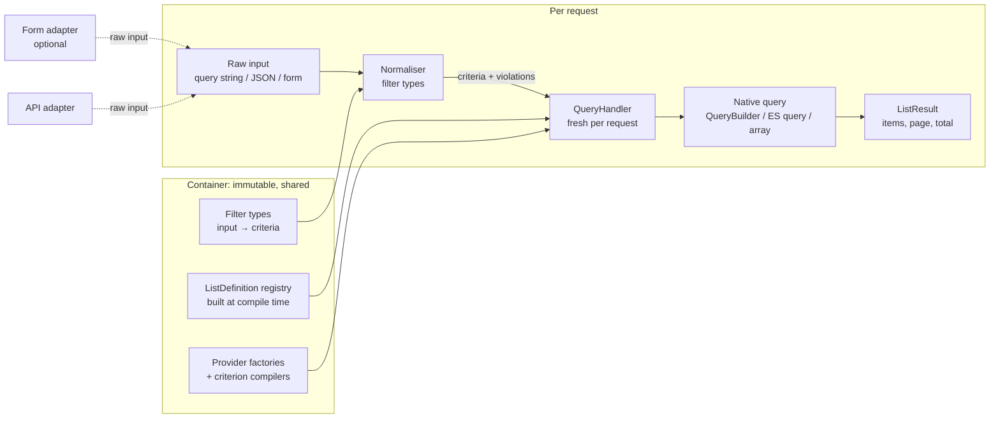

# Sidus/FilterBundle 7.0: design

Status: accepted with the owner's answers (section 17). Branch `v7.x` (forked from `v6.x` at v6.0.4).
Facts are labelled **[read]** (source or history read), **[verified]** (executed, mostly in
`filter-bundle-review.md`), or **[inference]**.

## 0. Goals and non-goals

Goals, in priority order:

1. **Request isolation by construction.** The container holds only immutable, request-agnostic objects.
   Everything that holds a query, sort state, page, form or join map is created per request and never stored in a
   service.
2. **One configuration, any data source.** A list definition (filters, sorting, pagination, count) means the same thing
   on Doctrine ORM, EAV, an in-memory array, a remote API or Elasticsearch. Where a data source cannot honour that
   meaning, the difference is explicit: either a configuration error or a documented, listed approximation.
3. **Symfony Forms are optional.** The core takes a plain array of input (query string or JSON body) and returns a
   result page. HTML forms are an adapter on top of it.
4. **Fail early.** Misconfiguration fails at container compile time (structure, types, capabilities) or at cache warm-up
   (attribute paths against Doctrine metadata), never on the first visitor's request.
5. **Deterministic native queries.** Same input shape gives the same DQL and the same parameter names, so Doctrine's
   query cache hits.

Non-goals for 7.0: GraphQL, cursor (keyset) pagination, full-text relevance scoring, an admin UI.

## 1. What history says (archaeology)

### 1.1 Join reuse

What this repository did, in order **[read]** (`git log -S uniqid`, `-G 'leftJoin\('`, `git show`):

| Commit | Date / first tag | Behaviour |
|---|---|---|
| `17aaa5a`, `185506f` | 2017 | Attributes with a dot were used verbatim as DQL (`author.name`): the consumer had to create the join and its alias himself, so "reuse" meant "every filter reuses the consumer's one join". |
| `e5b2942` "Fixing nested doctrine attributes" | 2018-08-03, v2.0.0 | `getFullAttributeReferences()` walks the path and adds `$qb->join($previous, uniqid('nested'))` per segment: **one fresh INNER JOIN per attribute reference**. |
| `de04c2e` "Fixing sort column alias resolving" | 2018-08-08 | Same logic moved to `DoctrineQueryHandler::resolveAttributeAlias()`, also used by the sort. |
| `e6e5630` / `1c590ad` "Using left join instead of inner join when resolving nested attributes" | 2020-04, v3.0.x | INNER JOIN replaced by LEFT JOIN (the inner join silently removed rows whose relation is null, including for the sort). |
| `d0fa29c` "Fixing choice SQL join issue properly" | 2020-04-20 | `ChoiceFilterType` clones the builder to undo the joins it creates while computing choices. |
| `7bba1e2` / `c8014f9` / `c3eb5c7` | 2021-2023 | Resolution moved to metadata-driven `getAttributeMetadata()` (then `DoctrineAttributeMetadataResolver`), join type made a parameter, `uniqid('nested'.ucfirst($attribute))` kept. |

There never was a memoised join in **this** repository. The "reuse caused issues" experience is in
`Sidus/EAVModelBundle` **[read]** (cloned in `/tmp/eavgit`):

- `176a8d8` (2017-04-27, v1.2.0) "Fixed EAV query builder: same join could be applied multiple times in certain
  conditions": `AttributeQueryBuilder` gets `$joinApplied`, each *attribute query builder* (one condition) owns its own
  join alias (`generateUniqueId`) and applies it once.
- `71d08f9` (2017-08) "Allowing join on attributes": relation joins through `join($alias = null)`, unique alias by
  default.

Why a per-condition join is the right default in EAV and on any to-many path **[inference, standard SQL semantics]**:
values live in a to-many table. "`tags` contains `a`" AND "`tags` contains `b`" means
*∃v₁: v₁ = a* ∧ *∃v₂: v₂ = b*. If both conditions share one join alias it becomes *∃v: v = a ∧ v = b*, which is always
empty. Sharing a join across *independent* criteria on a to-many path changes the meaning of the query. On a to-one
path sharing is always safe (there is at most one related row). The keres-platform `GamePlayerFilterType`
**[read]** documents the other face of the problem: a LEFT JOIN on a to-many collection "multipl[ies] rows (and
break[s] pagination counts)", so it uses an `EXISTS` subquery instead.

What the fresh-join behaviour protected, therefore: (a) independent criteria on to-many paths keep "any element
matches" semantics; (b) one filter cannot alter another filter's join (no shared `WITH` condition, no join-type
clash); (c) a consumer's own joins and aliases are never hijacked. What it costs: random aliases (query-cache miss on
every request, **[verified]** in the review), duplicated joins on to-one paths, and row multiplication on to-many paths
that forces the Paginator's three-query DISTINCT mode.

### 1.2 Pending filter types

`NotEmptyFilterType`, `NullFilterType`, `RegexpFilterType` are not in this repository's history (`git log --all` on
the names: only `NotNullFilterType`, added in `0214a43`) **[read]**. They exist in
`~/www/archives/qk-sds-api/src/Quarks/SdsAnalysis/AdminBundle/Filter/Type/` **[read]**:

- `NullFilterType`: `{column} IS NULL` when the checkbox is set (registered as `is_null` in `Line.yaml`).
- `NotEmptyFilterType`: calls `getAttributeMetadata($path, Join::INNER_JOIN)` and adds no WHERE at all: "not empty"
  is obtained as a side effect of an INNER JOIN, for relations only, always on (ignores `$data`).
- `RegexpFilterType`: combo `regexp|not_regexp|iregexp|not_iregexp` compiled to custom DQL functions `REGEXP`,
  `NOT_REGEXP`, `IREGEXP`, `NOT_IREGEXP` (PostgreSQL `~`, `!~`, through `martin-georgiev/postgresql-for-doctrine`
  `BaseFunction`).

### 1.3 The reference handler (`qk-sds-api` `DoctrineQueryHandler`) **[read]**

It extends the bundle's handler and adds:

1. **Named, reusable joins** declared in `options.joins` (key = entity class, `alias`, then either
   `reference: <field>` meaning `alias.field = e`, or `condition: [field, path]` meaning `alias.field = <resolved path>`,
   resolved recursively). A join is applied once per handler (`$appliedJoins`) on first use by any attribute starting
   with `<alias>.`. This joins **unrelated entities** (no Doctrine association), which the metadata resolver cannot do.
2. **JSON paths and casts in attribute strings**: `totals->regression::int` becomes
   `CAST(JSON_GET_FIELD(e.totals, 'regression') AS int)`, usable by any filter type and by the sort.
3. **Computed sort columns**: `statistics_<property>` columns become hidden SELECT expressions (ratio with
   `NULLIF`, empty-last flag, tie-breaker), i.e. a sort on an expression rather than on a field.
4. Pager switches `allowOutOfRangePages` and `fetchJoinCollection` (public mutable properties).

Better than the bundle: joins are deterministic and shared by name; unrelated entities are reachable; JSON documents
are first-class; sort can target an expression. Weak points: it is a fork (overrides of protected internals), the
join map is handler state (correct only because ComTSo-style per-request handlers are not used there either
**[inference]**), the JSON/cast syntax is parsed at request time and `::type` goes into DQL unvalidated (config-trusted
only), a shared named join on a to-many target multiplies rows silently, and the computed sort is hard-coded to one
entity class.

### 1.4 Existing providers (the real SPI requirements) **[read]**

| Provider | Where | What its handler needs |
|---|---|---|
| `doctrine` | this bundle | QueryBuilder, metadata resolver, Doctrine Paginator |
| `sidus.eav` (EAV) | `github.com/VincentChalnot/SidusEAVFilterBundle` (cloned `/tmp/eavf`, last commit 2019) | extends the Doctrine handler; adds a root condition (`family`), its own attribute resolution (attribute codes, `allowed_families` for nesting), per-condition joins, **a hydrating data loader on the result page** (`EAVAdapter` + `DataLoaderInterface`, `loader_depth`), query/result *contexts* |
| `sidus.elastica` | `github.com/VincentChalnot/SidusElasticaFilterBundle` (last commit 2018) | a `BoolQuery` root, filters add `must` clauses (`Wildcard('*x*')` for text, `Term` for choice), **pager and total from the search engine** (`findPaginated`) |
| `in_memory` | `qk-sds-api` `LogAnalyserBundle` | an array of objects/arrays, PropertyAccessor reads, `ArrayAdapter`. Contains a real bug: `applySort()` sorts `$this->data` after `applyFilters()` copied it into `$filteredData`, so the page is never sorted **[inference from code]**. |
| remote API | not found on this machine (`sidus/api-client-bundle` exists in `qk-sds-api/vendor` without a filter provider) | owner's description only: criteria mapped to query parameters, total from the response |

Nothing else on the machine implements `QueryHandlerFactoryInterface` (grep across `~/www`).
Custom filter types in apps: ComTSo `AdminRoleFilterType`, keres-platform `GamePlayerFilterType` (EXISTS subquery),
qk-sds-api `HashFilter` (bytea/hex), `SdsFileTextFilter` (fixed joins), `WorkspaceFilterType` (security-dependent
default). The new design must keep a native escape hatch for all of them.

## 2. Architecture overview



Two layers, strictly separated:

- **Filter type** (user-facing): validates and normalises one filter's raw input and emits abstract **criteria**. It
  knows nothing about data sources and nothing about Symfony Forms.
- **Criterion compiler** (data-source-facing): per provider and per criterion class, realises a criterion in the
  native query. Each provider publishes a **capability table** of what it supports and how.

This replaces `FilterTypeInterface::handleData(QueryHandlerInterface, FilterInterface, $data)` that mixed both
layers and forced one filter type per (provider, name) pair (eight Doctrine filter types, re-implemented by each
provider).

## 3. Packages and namespaces

Decision (owner): **split now**. Two Composer packages, two repositories:

- `sidus/filter-bundle` 7.0 (this repository): contracts, criterion vocabulary, filter types, the request pipeline,
  the in-memory reference provider, the shared contract test kit, and the optional Form / HTTP / Pagerfanta adapters.
  No dependency on Doctrine.
- `sidus/doctrine-filter-bundle` 1.0 (new repository `../SidusDoctrineFilterBundle`): the Doctrine ORM provider. It is
  the template the other providers (EAV, Elasticsearch, remote API) will follow later.

```
SidusFilterBundle/src/                PSR-4 Sidus\FilterBundle\ (code moved from the repository root to src/, tests/ out of the dist)
  Criterion/                          criterion vocabulary (section 4)
  Definition/                         ListDefinition, FilterDefinition, SortColumn, ... (readonly) + DefinitionFactory
  Input/                              ListInput, Violation, ViolationList
  Result/                             ListResult
  Provider/                           SPI: QueryHandlerFactoryInterface, QueryHandlerInterface, Capabilities,
                                      CountStrategyInterface, AbstractQueryHandler (pipeline)
  Filter/                             FilterTypeInterface + Type/ built-ins (text, choice, number, date_range, null, ...)
  Registry/                           ListDefinitionRegistry, QueryHandlerRegistry, FilterTypeRegistry
  InMemory/                           reference provider (arrays/objects): executable semantics
  Form/                               optional Symfony Form adapter and themes
  Http/                               optional request parser and result normalizer (API endpoints)
  Pagerfanta/                         optional ListResult → Pagerfanta adapter
  Test/Contract/                      shared contract suite shipped for provider packages (autoload only with PHPUnit)
  DependencyInjection/, SidusFilterBundle.php
SidusDoctrineFilterBundle/src/        PSR-4 Sidus\DoctrineFilterBundle\
  Factory/, Query/ (DoctrineQueryContext, JoinRegistry), Compiler/ (criterion compilers), Metadata/ (FieldResolver),
  Count/, Form/ (relation → EntityType mapper), DependencyInjection/, SidusDoctrineFilterBundle.php
```

Core `require`: `php >=8.4`, `symfony/config`, `symfony/dependency-injection`, `symfony/http-kernel`,
`symfony/options-resolver`, `symfony/property-access` (all `^8.1`). Optional (`suggest`, `require-dev`):
`symfony/form`, `symfony/twig-bridge`, `symfony/http-foundation`, `pagerfanta/core`. Optional integrations are
registered only when their classes exist.

Later: `sidus/eav-filter-bundle` 3.0 builds on the Doctrine bundle (a Doctrine dialect: own field resolver, root
condition customizer, result hydrator); Elasticsearch and remote-API providers depend on the core only.


## 4. Criterion vocabulary

A **field** is a logical attribute path from the list definition (`title`, `author.name`, `tags`, `totals.regression`),
resolved per provider (section 8). A **criterion** is an immutable value object; the vocabulary is closed in the core
and extensible by provider packages (a new criterion class plus its compilers).

| Criterion | Meaning (reference semantics = in-memory provider) |
|---|---|
| `Equals(field, value)` | value is strictly equal after type normalisation (strings case-sensitive, dates compared as instants, numbers numerically). |
| `In(field, values)` | `Equals` for any of the values. Empty list is rejected at normalisation (never "match nothing"). |
| `Contains(field, text, caseSensitive=false)` | substring match. Wildcards in `text` are literal (`%`, `_`, `*` escaped). Case folding is Unicode lower-case (`mb_strtolower`); accent folding is **not** part of the meaning. |
| `StartsWith`, `EndsWith` | same rules as `Contains`, anchored. |
| `Range(field, min?, max?, minInclusive=true, maxInclusive=true)` | ordered comparison for numbers and dates; covers `>`, `>=`, `<`, `<=` and date ranges. A date-only upper bound means end of that day (normalised by the date filter type, not by providers). |
| `IsNull(field)` | value is null or the property is absent. For a to-one relation: no related entity. |
| `IsEmpty(field)` | null, empty string, or empty collection. `NotEmpty` = `Not(IsEmpty)`. |
| `Matches(field, pattern, caseSensitive=true)` | POSIX ERE subset (documented: `.`, `[]`, `*`, `+`, `?`, `{m,n}`, `^`, `$`, `|`, groups; no backreferences, no lookaround) so it means the same in PCRE, PostgreSQL, MySQL 8 ICU and Elasticsearch (the latter is anchored: compiler adds `.*` where needed). |
| `Not(criterion)`, `AnyOf(criteria)`, `AllOf(criteria)` | boolean composition. A filter with several attributes emits `AnyOf` over them (current OR behaviour). |
| `Native(provider, payload)` | escape hatch: provider-specific, opaque to other providers (section 6). |

Rules common to every criterion:

- **To-many fields mean "any element"**: `Contains(tags.label, 'x')` is true if at least one tag's label contains `x`.
  Two criteria on the same to-many path are independent (each has its own "any"). This is the EAV-proven semantic of
  section 1.1, now written down and tested.
- **Null never matches a comparison** (`Equals`, `Contains`, `Range`, `Matches` are false on null), like SQL three-valued
  logic collapsed to false, so `Not(Contains(x))` is true for null. Arrays, SQL and ES all get this right only if
  compilers are written for it, hence contract tests (section 13) cover nulls explicitly.

Sorting is a criterion too: `Sort(list<OrderBy(field, direction)>)`, emitted by the `sort` filter type and compiled by
each provider like any other criterion (stable: the provider appends the identifier as tie-breaker; nulls sort first
ascending, last descending, as in PHP's `<=>` reference). At most one sort filter can be active per list. Pagination
(`page`, `per_page`) is not a criterion: it is part of `ListInput` and validated against `pagination.max_per_page`.

## 5. Filter types (user-facing layer)

```php
interface FilterTypeInterface
{
    public static function getName(): string;                           // 'text', 'choice', ...

    /** Validate the filter's own options at compile time (OptionsResolver). Static: no service exists yet. */
    public static function configureOptions(OptionsResolver $resolver): void;

    /** Operations this filter can emit for this definition: used for capability checks at compile time. Static. */
    public static function getRequiredOperations(FilterDefinition $filter): array; // list<class-string<Criterion>>

    /** Raw input (string/array from query, JSON, form, or configured default) → normalised value or violations. */
    public function normalize(FilterDefinition $filter, mixed $raw): NormalizedValue;   // value|empty|violations

    /** Normalised value → criterion (null when the filter is inactive). */
    public function buildCriterion(FilterDefinition $filter, mixed $value): ?Criterion;
}
```

Filter types are provider-independent, registered once by name (no more `[provider][name]` matrix). Built-in types:

| Type | Input | Emits | Replaces (v6) |
|---|---|---|---|
| `text` | string, or `{operator, value}` when `options.operators` lists several | `Contains` (default), `StartsWith`, `EndsWith`, `Equals`, `Not(..)`, `IsNull`, `IsEmpty` | `text`, `advanced_text` |
| `exact` | scalar | `Equals` | `exact` |
| `choice` | scalar or list; choices from `options.choices` or from the provider's distinct values | `Equals` / `In` | `choice`, `custom_choice` |
| `relation` | identifier(s) | `In(field.id, ids)` | `entity` |
| `number` | number, or `{operator, value}` | `Equals`, `Range`, `IsNull` | `advanced_number` |
| `date_range` | `{from, to}` (ISO 8601 strings or DateTimeInterface) | `Range` | `date_range` |
| `null` / `not_null` | boolean flag | `IsNull` / `Not(IsNull)` | `not_null`, qk `NullFilterType` |
| `not_empty` | boolean flag | `Not(IsEmpty)` | qk `NotEmptyFilterType` (now an explicit criterion, not an INNER JOIN side effect) |
| `regexp` | `{operator: matches|not_matches|imatches|not_imatches, value}` | `Matches` / `Not(Matches)` | qk `RegexpFilterType` |
| `sort` | see section 9 | `OrderBy[]` | `SortConfig`, `sortable`, `default_sort` |
| `native` | anything | `Native` built by a callable service | `handleData` overrides |

What is kept from v6: the *filter* (named, configured, with `attributes`, `default`, `label`, `options`), the
multi-attribute OR, the type registry autoconfigured by interface. What is cut: `handleData(QueryHandlerInterface,...)`,
`getFormType()`/`getFormOptions()` on the filter type (moved to the form adapter), the provider dimension of filter
types, the `BadQueryHandlerException` type checks. Combo option codes (`_like_`, `notlike_`, `greaterthanequals`) are
replaced by operator names (`contains`, `not_starts_with`, `gte`); translation keys follow.

Custom filter types written for an app (ComTSo `AdminRoleFilterType`, keres `GamePlayerFilterType`) either compose
core criteria (`AnyOf(Contains(players.user.username), Contains(players.user.email), ...)`, which the Doctrine provider
compiles to one `EXISTS` per to-many path, i.e. exactly what `GamePlayerFilterType` writes by hand) or emit `Native`.

## 6. Capability negotiation and vendor-specific realisation

Decision (owner): **strict**. A provider either realises a criterion with the reference meaning or refuses it; there
are no approximations. Each provider factory publishes `Capabilities`: for each criterion class, supported or not,
possibly depending on the field (`supports(criterion class, field): ?string` returns null or the refusal reason).
Examples: `Matches` on Doctrine is supported only if the configured regexp DQL functions are registered; an
Elasticsearch `Contains` would be supported on `keyword`/`wildcard` fields only, never on analysed `text`.

Resolution happens at container compile time for everything that does not need runtime services (filter type exists,
options valid, provider capability tables) and at cache warm-up for field-dependent checks (Doctrine metadata): an
unsupported criterion is a **configuration error** naming the list, the filter, the criterion and the reason. A filter
may narrow its own operators (`operators: [contains, starts_with]`) so that an unsupported one is never emitted.
There is no "silently skip at runtime" mode.

**Provider-specific filters** (owner's requirement): a filter may declare `providers: [elasticsearch]`. It is then
active only when the list's provider is one of those, and *ignored entirely* otherwise (no form field, no API input,
no capability check). Together with a public `name` (defaults to the filter key, must be unique among the filters
active for the list's provider) this lets one configuration carry different strategies over the same attribute and
switch providers without editing it:

```yaml
provider: '%app.list_provider%'   # a parameter, not an env var: the provider must be known at compile time
                                  # (parameters: app.list_provider: elasticsearch; when@dev: parameters: app.list_provider: doctrine)
filters:
    title_fulltext: { name: title, type: es_match, attributes: [title], providers: [elasticsearch] }
    title_like:     { name: title, type: text, attributes: [title], providers: [doctrine, in_memory] }
    status:         { type: choice, options: { choices: [draft, published] } }   # portable: no 'providers'
```

An approximate realisation (ES `match_phrase_prefix` for "contains") is therefore never a variant of a portable
criterion: it is a provider-specific filter type (or criterion) shipped by that provider and used under `providers:`.

**Vendor-specific options** stay per filter, under the provider's name, validated by that provider and ignored by the
others; they tune *how* a supported criterion is realised, never *what* it means:

```yaml
filters:
    title:
        type: text
        provider_options:
            doctrine: { case_insensitive: ilike }   # lower (LOWER() both sides, default) | ilike (custom DQL function)
```

Compilers are services implementing `CriterionCompilerInterface` of their provider, indexed by the provider factory
from an autoconfigured tagged iterator (criterion class read from the compiler), not through a `defaultIndexMethod`
locator. An app or provider package adds a compiler for a new criterion, or decorates an existing one.

## 7. Configuration

### 7.1 Format

```yaml
sidus_filter:
    lists:                                   # was: configurations
        posts:
            provider: doctrine
            options: { entity: App\Entity\Post }   # provider-validated
            pagination: { per_page: 15, max_per_page: 100 }   # was: results_per_page
            count: auto                             # auto | none | <service id>; section 10
            filters:
                title: { type: text, operators: [contains, starts_with, equals] }
                author: { type: text, attributes: [author.name, author.email] }
                published: { type: date_range, attributes: [publishedAt] }
                tags: { type: relation }
                status: { type: choice, options: { choices: { draft: draft, published: published } }, default: published, locked: true }
                sort:
                    type: sort
                    options:
                        columns: { title: title, date: publishedAt, author: author.name }   # public key → field
                        default: [ { column: date, direction: desc } ]
```

`label` and `form_type`/`form_options` move to a `form:` sub-key read only by the form adapter. `hidden` becomes
`locked: true` (value fixed by configuration, never read from input, still normalised through the same filter type:
fixes v6 hidden filters bypassing transformers). `name` (public input name, defaults to the key) and `providers`
(section 6) are optional. An attribute is a dotted path string, or `{ path: totals, json: [regression], cast: integer }`
for JSON documents (section 8.3).

### 7.2 Compilation

The extension processes the tree, then a compiler pass (after all providers and filter types are registered) builds
every `ListDefinition` value object (readonly classes, no setters, no back-references), runs filter-type option
resolution and the capability checks of section 6, and passes the definitions to `ListDefinitionRegistry` as a plain
constructor argument (scalars/arrays, rebuilt into objects once and memoised; they are immutable, so the memo is safe).
Field resolution that needs runtime services (Doctrine metadata) runs in a cache warmer and in
`bin/console lint:sidus-filter`, so `cache:warmup` (and therefore deploy and CI) fails on a bad path.

### 7.3 Old → new mapping (upgrade note)

Decision (owner): **clean break**, no shorthands and no compatibility loader; `UPGRADE-7.0.md` lists the mapping:

| v6 | v7 |
|---|---|
| `sidus_filter.configurations.<code>` | `sidus_filter.lists.<code>` |
| `results_per_page: 15` | `pagination.per_page: 15` |
| `sortable: [a, b.c]` + `default_sort: {a: desc}` | a `sort` filter: `columns: {a: a, c: b.c}`, `default: [{column: a, direction: desc}]` |
| `type: text` | `type: text` (operator `contains`) |
| `type: advanced_text` | `type: text` with `operators: [contains, starts_with, ...]` |
| `type: advanced_number` | `type: number` with `operators: [...]` |
| `type: custom_choice` / `choice` | `type: choice` |
| `type: entity` | `type: relation` (Doctrine bundle) |
| `type: not_null` | `type: not_null` |
| `options.hidden: true` | `locked: true` |
| `label`, `form_type`, `form_options` | `form: { label, type, options }` |
| `default:` | unchanged, normalised like user input |
| `provider: doctrine` | unchanged, requires `sidus/doctrine-filter-bundle` |
| qk `options.joins` | `options.joins` (section 8.3, renamed keys) |
| qk `totals->regression::int` | `{ path: totals, json: [regression], cast: integer }` |

## 8. Doctrine provider

### 8.1 Field resolution

A `ResolvedField` (immutable, memoised per list) is computed from metadata once: list of segments, each
association typed `to_one`/`to_many`, terminal field type, optional JSON path and cast. Unknown segment,
scalar-in-the-middle, or a cast outside the allow-list (`integer`, `float`, `string`, `boolean`, `date`) is a warm-up
error. No request input is ever resolved: sort columns and filter attributes all come from configuration.

### 8.2 Join strategy

Per request, a `JoinRegistry` inside the `DoctrineQueryContext` (the per-request query object, not a service):

- **To-one path prefixes are shared**: one `LEFT JOIN` per distinct prefix, aliases derived from the path
  (`author` → `author_`, `author.company` → `author_company_`, numeric suffix on collision, in deterministic
  definition order). Safe because a to-one join never changes cardinality nor the meaning of other criteria.
- **To-many paths compile to correlated `EXISTS` subqueries per criterion**, with their own aliases (`x1_tags`,
  numbering by criterion position). This preserves the per-criterion "any element" semantics the EAV bundle and the
  fresh joins protected, never multiplies rows, and lets pagination use a plain `LIMIT/OFFSET` with a cheap count.
- **Sorting on a to-many path** is a configuration error unless the column declares an aggregate
  (`{field: comments, aggregate: count|min|max}`), compiled as a hidden select.
- **Join type**: always LEFT for shared to-one joins (an inner join would filter rows for the sort too: what
  `e6e5630` fixed). Criteria in WHERE give inner semantics when they need it.
- **Parameters** are named `p1`, `p2`, ... in compilation order (definition order of active filters). DQL varies only
  with *which* filters are active, a finite set of shapes → query-cache hits. Test: identical input twice gives
  byte-identical DQL; differing values give identical DQL.
- **Opt-in shared to-many**: `provider_options.doctrine.join: shared` on a filter, or the same *named join*
  (8.3) used by several filters, gives "the same element satisfies all of them" semantics deliberately; the list then
  switches its default count and fetch to the DISTINCT mode, which is reported by `debug:sidus-filter`.

### 8.3 Named joins and JSON paths (port of the qk-sds-api handler)

```yaml
options:
    entity: Quarks\...\Line
    joins:
        language:                                     # alias, usable as a path root: language.language
            entity: Quarks\...\SdsFileLanguage
            on: { field: sdsFile, equals: page.pages.sdsFile }   # alias.sdsFile = <resolved path>
            cardinality: one                          # one | many: many makes it behave like a to-many path
```

A named join is added once per request on first use (shared scope by declaration), its `equals` path is resolved with
the same rules (so it may itself use shared to-one joins), and it is validated at warm-up. `cardinality: many` names
are compiled like to-many paths (EXISTS) unless `shared: true`.

JSON: `{ path: totals, json: [regression], cast: integer }` (or the `totals->regression::int` shorthand, parsed at
compile time). Compilation goes through a `JsonPathCompilerInterface` service; the shipped one targets the
`martin-georgiev/postgresql-for-doctrine` functions used by qk-sds-api (`JSON_GET_FIELD`, `JSON_GET_FIELD_AS_TEXT`,
`JSON_GET_FIELD_AS_INTEGER`); a JSON field without a registered compiler is a warm-up error. The in-memory provider
reads JSON paths as nested array keys and Elasticsearch as object sub-fields, so the same path means the same thing
on all three.

Expression sort columns (qk's computed statistics) become a `sort` column with
`provider_options.doctrine.expression: '...{root}...'`, allow-listed by construction because it lives in
configuration.

### 8.4 Consumer extension point

ComTSo's `prepareQuery()` hooks add joins/selects between `buildForm()` and `handleRequest()`. v7 makes it explicit:

```php
$handler = $registry->createQueryHandler('topics');
$result = $handler
    ->withCustomizer(static fn (DoctrineQueryContext $q) => $q->queryBuilder()->addSelect(...)->leftJoin(...))
    ->handle($input);
```

Customizers run on the freshly created builder before criteria are applied; they get the root alias and the
`JoinRegistry` (to reuse a shared to-one alias instead of adding their own). The builder is never returned to the
consumer outside a customizer, so there is no ordering trap.

## 9. Sorting as a filter

The `sort` filter type takes `-date,title` (API style), `[{column: date, direction: desc}]`, or the form adapter's
structure, and emits a `Sort` criterion. Its `columns` option maps **public keys** to fields: the input names a key,
never a property path, so the allow-list is structural (`author.password` is not a key, therefore cannot be
requested). Unknown key, malformed direction, or more than `max_columns` → violations (section 11). The provider
appends the identifier as final tie-breaker (stable pages). `default` applies when the input has no valid sort.

## 10. Count strategy

```php
interface CountStrategyInterface
{
    public function count(QueryContextInterface $query, ListDefinition $list, ListInput $input): ?int; // null = unknown
}
```

- `auto` (default): the provider's native count. Doctrine: `SELECT COUNT(root.id)` on a clone without ORDER BY and
  without fetch joins (with EXISTS for to-many there is no duplication; DISTINCT mode only when a shared to-many join
  exists). In-memory: `count()`. Elasticsearch: `hits.total` with `track_total_hits` (approximate above the configured
  threshold, flagged in the result).
- `none`: no total (result exposes `hasNextPage` by fetching `size + 1`), for APIs on huge tables.
- A **service id**: any `CountStrategyInterface` (cached counts, a dedicated optimised query; replaces
  `ManualCountAdapterInterface` users).
- **Per request**: `$input->withTotalCount(int)` or `->withTotalCount(fn () => $cache->get(...))` (lazy). This is the
  first-class version of `setNbResults()`.

The total is computed lazily (only if the result's `total()` is read) and once.

## 11. Request lifecycle and input errors

```php
$handler = $queryHandlerRegistry->createQueryHandler('posts');   // new object every call; never cached
$result  = $handler->handle(ListInput::fromArray($request->query->all()));   // single use: second handle() throws
$result->items(); $result->page(); $result->perPage(); $result->total(); $result->violations(); $result->state();
```

`ListInput` is `{filters: array<code, raw>, sort: raw, page: raw, per_page: raw}`. Normalisation never throws on user
input: each invalid part becomes a `Violation` (path, message, invalid value) and that part falls back to its default
(page 1, default sort, filter inactive). The violations travel in the result; adapters decide:

- API (`Bridge/HttpFoundation`): `strict` by default → 400 with the violation list.
- HTML (form adapter): violations mapped to form errors, page rendered with defaults for invalid parts.

`$result->state()` is the normalised, applied state (what the form adapter renders back and what an API echoes).

Registry public API: `createQueryHandler(string $code): QueryHandlerInterface`, `getDefinition(string $code):
ListDefinition`, `has(string $code): bool`. No `add*` methods: definitions come only from configuration (DataGrid
registers its inline query handlers through a documented container tag/extension prepend at compile time, section 14).

## 12. Optional adapters

### 12.1 Symfony Form

`Bridge/Form/ListFormFactory::create(ListDefinition, ?ListState): FormInterface` builds a GET form: one child per
non-locked filter, mapped by a `FormFilterMapperInterface` registered **per filter type name** (provider-independent;
the Doctrine bridge adds the mapper for `relation` → `EntityType` with the resolved target class and a choice loader
limited to related ids, without touching the main query). The form's submitted data is converted back to *raw input*
and goes through the same normaliser as an API call; the form never applies anything to a query.
Sort UI: a `sort` child with one button per column key plus the current state, rendered by `sidus_filter_sort_*` blocks
(DataGrid header cells use `form.filters.<sortFilterName>.vars.columns[key]` instead of `formView.sortable[index]`; the sort field lives in the `filters` child, see §18). Global `DateExtension` and
`DoctrineEntityExtension` are removed: string defaults are handled by the normalisers. Themes (owner): an unstyled
base theme, Bootstrap 6 (built against the 6.0 alpha markup), Bulma 1, and a Tailwind skeleton given as an example.

### 12.2 API endpoint

`Bridge/HttpFoundation/ListRequestParser` (query string `filters[title]=x&sort=-date&page=2&per_page=50`, or the same
structure as a JSON body) and `ListResultNormalizer` producing
`{items, page, per_page, total, pages, sort, filters, violations}` (`items` serialised by the app's serializer and
groups). An `ArgumentValueResolver` for `ListInput` and an optional generic controller are thin helpers on top.

### 12.3 Pagerfanta

`Bridge/Pagerfanta/ListResultAdapter` exposes a `ListResult` as a Pagerfanta adapter (DataGrid templates keep
`pager`-based pagination).

## 13. Testing strategy

Run in Docker (local PHP lacks `pdo_sqlite`): `docker run --rm -v $PWD:/app -w /app comtso-php-dev composer test`
(PHP 8.5, pdo_sqlite, pdo_pgsql). PHPUnit 12. The Doctrine bundle mounts the parent directory to use the core through a
Composer path repository.

1. **Worker-mode test** (first, red on v6 code): micro-kernel with SQLite, one booted kernel, three requests through
   the same container; asserts no exception, no leaked filter, single ORDER BY, stable DQL. Plus two handlers for one
   code inside one request.
2. **Unit tests** per filter type (normalisation, violations, emitted criteria) and per value object.
3. **Shared contract suite** (`Tests/Contract/`): one fixture dataset (posts, authors, to-many tags, nulls, empty
   strings, mixed case, Unicode, equal sort keys) defined once as PHP arrays and loaded into each provider (array of
   objects, SQLite schema through Doctrine). Cases are data: `[list definition, input, expected ordered ids, expected
   total, expected violations]`. `AbstractProviderContractTestCase` runs every case; `InMemoryProviderTest` is the
   reference, `DoctrineSqliteProviderTest` second, `DoctrinePostgresProviderTest` when `SIDUS_FILTER_PG_DSN` is set,
   Elasticsearch in its own package with the same suite class.
4. **Divergences are data too**: strict mode means a supported criterion must behave like the reference. A provider
   test may still declare `knownDivergences(): array<caseId, reason>` for a platform limitation found by the suite
   (for example SQLite `LOWER()` folds ASCII only); the suite asserts that a declared divergence *does* diverge, so the
   list cannot rot, and each entry is either fixed or turned into a capability refusal before release.
5. **Doctrine-specific**: DQL determinism, one join per to-one prefix, EXISTS per to-many criterion, count query shape,
   named joins, JSON paths (PostgreSQL only).
6. **Container**: compiles with zero deprecations under Symfony 8.1, misconfigurations fail at compile/warm-up
   with the intended messages.
7. CI: GitHub Actions matrix PHP 8.4/8.5 × Symfony 8.1/8.x, lowest/highest dependencies, PostgreSQL service.

## 14. Migration

**SidusDataGridBundle (5.0, owner's change; this bundle does not edit it):**

- `DataGridRegistry` keeps configurations only and builds a new `DataGrid` per `getDataGrid()` call; the `DataGrid`
  gets a fresh handler from `QueryHandlerRegistry::createQueryHandler()`.
- Inline `query_handler` blocks: `SidusDataGridExtension::prepend()` appends them to `sidus_filter.lists` as
  `__sidus_datagrid.<code>` (remove the runtime `addRawQueryHandlerConfiguration`).
- `DataGrid::buildForm()/handleRequest()` → `ListFormFactory::create()` + `$handler->handle(ListInput)`;
  `getPager()` → `ListResultAdapter`.
- Twig: `datagrid.queryHandler.configuration.sortable` → the sort filter's columns (`datagrid.definition.findSortFilter().options.columns`),
  `datagrid.queryHandler.pager` → `datagrid.pager`, `datagrid.formView.sortable[index]` → `datagrid.formView.filters[<sortFilterName>].vars.columns[key]`
  (implemented sort field location, see docs/MIGRATION-CONSUMERS.md);
  combo translation keys renamed (`sidus.filter.operator.contains`, ...).
- Require `sidus/filter-bundle ^7.0` (its current `>=4.0` must be capped).

**ComTSo:** bump both bundles, delete `RequestScoped{QueryHandler,DataGrid}Registry`, `RequestScopedDatagridPass`, the
`Kernel::build()` registration and `ListAction::restrictSortColumn()`; keep `tests/Admin/WorkerModeTest.php`; port
`prepareQuery()` hooks to customizers; port `AdminRoleFilterType` to a `choice`/criteria type; rename config keys
(7.3).

**EAV filter bundle 3.0:** Doctrine dialect: own `FieldResolver` (attribute codes, families), own root condition
customizer, own hydrating result post-processor (hook `ResultHydratorInterface` on the Doctrine provider).

## 15. Versioning and release plan

- 7.0.0 is a clean cutover (no 6.1 deprecation layer): every known consumer is the owner's, pinned to old versions.
- `v6.x` keeps receiving security fixes only; a 6.0.5 with the minimal registry fix is possible on request.
- Work happens on `v7.x`; tags and pushes are the owner's.

## 16. What is cut, and why

| Cut | Why |
|---|---|
| `QueryHandlerRegistry` caches, `unset`, `addRaw*`/`add*` | root cause of the defect; immutable definitions instead |
| `FilterFactory*`, `QueryHandlerConfigurationFactory*`, `QueryHandlerConfigurationInterface`, `FilterInterface` | one implementation each; readonly value objects |
| `SortConfig`, `SortConfigType`, `OrderButtonType`, hidden sort fields | sorting is a filter with keys; source of the column/direction/page bugs |
| `FilterTypeInterface::handleData()` and provider-specific filter types | split into filter types + criterion compilers |
| `DateExtension`, `DoctrineEntityExtension` | global side effects on the host app; defaults are normalised as input |
| `ManualCountAdapterInterface`, own `DoctrineORMAdapter` | replaced by `CountStrategyInterface` and per-request totals |
| `getQueryBuilder()`/`setQueryBuilder()` on the handler | replaced by customizers; `ChoiceFilterType` no longer swaps builders |
| `uniqid()` aliases/parameters | deterministic names |
| Bootstrap 3/4 form themes | replaced by base, Bootstrap 6, Bulma 1, Tailwind example |
| Tagged locator with `defaultIndexMethod` | deprecated in Symfony 8.1 |

## 17. Owner's decisions (2026-10-20)

| Question | Decision |
|---|---|
| Packaging | Split now: core `sidus/filter-bundle` + new `sidus/doctrine-filter-bundle` repository; other providers follow later |
| Unsupported operations | Strict: configuration error on any divergence, no approximations; filters can be restricted with `providers: [...]` and are ignored for other providers |
| Vendor overrides | Per filter, under the provider name (`provider_options.<provider>`) |
| Invalid input | Collect violations; adapters decide (API 400, form errors) |
| API endpoints | Request parser + result normalizer in 7.0 |
| Versions, themes | PHP 8.4+, Symfony 8.1+; Bootstrap 6, Bulma 1, Tailwind skeleton example |
| Doctrine pagination/count | Own implementation |
| v6 YAML | Clean break, upgrade note only |

## 18. Implementation notes (decisions where this document was silent)

- Code lives in `src/`, tests in `tests/` (`Sidus\FilterBundle\Tests\`), bundle configuration in `config/`. The v6
  worker-mode test, kernel and controller were deleted with the Doctrine code; the Doctrine bundle re-creates the
  SQLite flavour, the core carries a container-level worker test on the in-memory provider (step "DI").
- **Fields**: criteria hold a `Definition\Field` (path, JSON path, cast); a string is parsed (`totals->regression::int`,
  casts `int`/`bool` are aliases of `integer`/`boolean`). Sort columns are `OrderBy` value objects inside `Sort`.
- **`ListInput`** is `{filters, page, perPage, totalCount}`; `fromArray()` maps a top-level `sort` to `filters['sort']`
  (the conventional public name of the sort filter). The `sort` of section 11 is therefore an ordinary filter input.
- **`ListResult::hasNextPage()`** is exact for `count: none` (the handler fetches `per_page + 1`) and derived from the
  (lazy) total otherwise.
- **Definitions are dumped as arrays** (`toArray()` / `fromArray()`): the compiler pass resolves configuration into
  these arrays, the registry rebuilds the readonly objects once.
- **Filter types**: `operators` is an option (`options.operators`), not a top-level filter key; the first entry is the
  default operator for a bare value. Operator names: text `contains|not_contains|starts_with|not_starts_with|ends_with|
  not_ends_with|equals|not_equals|is_null|is_not_null|is_empty|is_not_empty`; number `eq|neq|gt|gte|lt|lte|is_null|
  is_not_null`; regexp `matches|not_matches|imatches|not_imatches`.
- `choice` without `choices` accepts any scalar; choices derived from the provider's distinct values are an adapter
  concern, not a core one. `multiple: true` is required to accept a list.
- `date_range`: date-only bounds are interpreted in the `timezone` option (default UTC); both bounds inclusive.
- `regexp` patterns are validated against the portable ERE subset (`Criterion\PosixRegex`, also the in-memory
  reference): no `(?`, no alphanumeric escapes (`\d`, `\1`), no possessive quantifiers, max 255 bytes.
- `sort`: columns are `key => path | {path,json,cast} | {field, provider_options}`; `provider_options` of the column end
  up in `OrderBy::providerOptions` keyed by provider (aggregate/expression for Doctrine). Invalid sort input yields
  violations and the pipeline then falls back to `normalize($filter, null)`, i.e. the configured `default`.
- `native`: `options.builder` names a `NativeCriterionBuilderInterface` service (tag `sidus_filter.native_builder`).
- **Filter type contract, two halves** (revised after the first implementation): `getName()`, `configureOptions()` and
  `getRequiredOperations()` are **static** (compile time, called on the class, like the provider factory's static
  methods); `normalize()` and `buildCriterion()` are instance methods that run per request and may use injected services
  (a type with constructor dependencies is fine). The compiler pass never instantiates a filter type. Configured
  `default:` values are therefore *not* checked at compile time: `Definition\DefaultsValidator`, run by the non-optional
  `CacheWarmer\DefaultsWarmer` (`kernel.cache_warmer`), normalises each default with the real instances, so an invalid
  default fails `cache:warmup` (and the first cache build, in debug) instead of the first request. Two services with
  the same type name are a compile-time error. `Filter\Type\BuiltInFilterTypes::classes()` lists the shipped types.
- **Capability negotiation** is compile-time and static: a provider's `Capabilities` is the set of criterion classes
  for which a `CriterionCompilerInterface` (static `getProvider()`/`getCriterionClass()`) is registered, optionally with
  explicit refusal reasons that win. `Definition\DefinitionResolver` (pure) validates a processed list config:
  provider, list options and `provider_options.<provider>` (static `configureListOptions`/`configureFilterOptions` of
  the factory), filter options, attributes, `locked` requires a default, public
  name uniqueness among *active* filters, at most one sort filter, and every criterion class a filter can emit must be
  supported. A filter whose `providers:` excludes the list's provider is dropped before any check. Field-dependent
  refusals (Doctrine metadata) are the provider's cache-warm-up concern.
- **Request pipeline** (`Provider\AbstractQueryHandler`, final `handle()`): a filter absent or null in the input takes
  its default; an explicitly blank value (`''`, `[]`) clears the default; a locked filter ignores the input. An invalid
  part is reported as a violation (`filters.<name>[.<sub-path>]`, `page`, `per_page`) and falls back to the filter's
  default (inactive without one). `page` and `per_page` are positive integers or digit strings; `per_page` is bounded by
  `pagination.max_per_page`. Providers only implement `createContext`, `applyCriterion`, `applySort`, `fetch`,
  `countNative`; the per-request query object is a `QueryContextInterface`.
- **In-memory provider** (`provider: in_memory`): list options `source` (id of an `InMemorySourceInterface` service,
  tagged `sidus_filter.in_memory_source`) and `identifier` (tie-breaker field, default `id`). Strings compare byte-wise
  (not locale-aware), numbers numerically (a numeric string meets a number), dates as instants (an ISO string meets a
  date); incomparable values never match. Without a sort filter the source order is kept; a to-many sort column sorts
  by its first element. JSON paths read nested array keys (or a JSON string), casts follow `Field::CASTS`.
- **Contract kit** (`Sidus\FilterBundle\Test\Contract`): `FixtureDataset` (arrays), `ContractCases` (data: input, ordered
  ids, total, violation paths) and `AbstractProviderContractTestCase` (`providerName()`, `listOptions()`,
  `createHandler()`, optional `knownDivergences()`); also checks single use and a lazily supplied total.
- **Count** (section 10): `auto` = `countNative()`, `none` = unknown total and `hasNextPage()` from fetching
  `per_page + 1` (skipped when the caller supplies a total), any other `count:` value is a `CountStrategyInterface`
  service id (created without it, `handle()` throws). A strategy may return null (unknown). The provider contract
  kit's `createHandler()` takes the optional strategy.
- **DI**: `SidusFilterBundle` is an `AbstractBundle` (tree in `configure()`, services in `config/services.php`).
  Autoconfigured interfaces and their tags: `FilterTypeInterface` → `sidus_filter.filter_type`,
  `QueryHandlerFactoryInterface` → `sidus_filter.provider_factory`, `CriterionCompilerInterface` →
  `sidus_filter.criterion_compiler`, `InMemoryCriterionCompilerInterface` → `sidus_filter.in_memory_compiler`,
  `InMemorySourceInterface` → `sidus_filter.in_memory_source`, `NativeCriterionBuilderInterface` →
  `sidus_filter.native_builder`. Registries index their tagged iterators once (no `defaultIndexMethod`).
- `ListDefinitionPass` (before optimisation, priority 0) reads `sidus_filter.raw_lists` (then removes it), resolves
  `%parameters%`, runs `DefinitionResolver` and passes the resolved arrays as `$definitions` to `ListDefinitionRegistry`;
  a `count:` service id must exist and implement `CountStrategyInterface`; a provider registered twice is an error.
  `ListDefinitionRegistry` and `QueryHandlerRegistry` are public; `FilterTypeRegistry` is private.
- `QueryHandlerRegistry` API: `has`, `getDefinition`, `codes`, `createQueryHandler` (new handler per call).
  `bin/console debug:sidus-filter [code]` lists lists, or one list with its active filters and the criteria they emit
  (registered when symfony/console exists).
- Not validated at compile time (needs runtime services): that an in-memory `source` service exists (reported when the
  handler is created).
- **Form adapter** (`Sidus\FilterBundle\Form`, loaded when symfony/form is installed and the form framework is on;
  `OptionalServicesPass` removes it otherwise): `ListFormFactory::create()` (a root form named `''`, method GET, one
  `filters` child with a field per active, non-locked filter whose type has a `FormFilterMapperInterface`, plus a
  hidden `page`), `submit($form, $query): ListInput`, `addViolations($form, $result)`. Mappers are tagged
  `sidus_filter.form_mapper` and indexed by filter type; a filter type without a mapper (e.g. `native`) has no field.
  Initial data = the normalised default converted by `toFormData()`. `submit()` passes the query's value for a
  filter on untouched (so an invalid value becomes a violation, not a silent null) and only falls back to the field's
  initial data, through `toRaw()`, for what the query lacks. The filter's `form: {label, type, options}` is applied
  on top of the mapper's defaults. The form may add its own transformation error next to a violation.
  Sort field: `SortType` (hidden input with the API-style value) exposes `vars.columns[key] = {key, direction,
  primary, next}`; themes render one submit button per key (`aria-sort` on the primary one).
- **Themes** (`@SidusFilter/form/...`): `base` (unstyled), `bootstrap_6`, `bulma_1`, all `use`ing `_blocks.html.twig`;
  `docs/examples/tailwind.html.twig` is an example, not shipped. Symfony ships no Bootstrap 6 layout, so
  `bootstrap_6` extends `bootstrap_5_layout.html.twig` and overrides the Sidus blocks with classes expected to stay in
  Bootstrap 6 (`.btn`, `.input-group`, `.form-select`) [INFERENCE: not checked against a Bootstrap 6 build].
  Translations en/fr in the `messages` domain: `sidus.filter.date_range.*`, `sidus.filter.operator.<operator>`,
  `sidus.filter.sort.*` (the v6 `combo` keys are gone with the combo option codes).
- Small additive core changes made for the adapters: `ListDefinition::findSortFilter()` and the `$sortFilter`
  parameter of `ListInput::fromArray()` (the sort filter need not be named `sort`).
- **HTTP adapter** (`Sidus\FilterBundle\Http`): `ListRequestParser` (query string, or the same structure as a JSON
  body; body values replace the query's; keys configurable under `sidus_filter.http`: `filters_key` (empty = top-level
  parameters are filters), `sort_key`, `page_key`, `per_page_key`; the sort value feeds the list's sort filter whatever
  its name), `ListResultNormalizer` (`{items, meta: {page, per_page, total, pages, next}}`, items through an optional
  callable), `ListResponseFactory` (strict by default: `400 application/problem+json` with `violations[{path,
  message}]`, never the submitted values; `http.strict: false` answers 200 with the defaults and a `violations` key),
  `#[MapListInput('code')]` + `ListInputValueResolver` (a targeted value resolver). Malformed JSON is a 400 from the
  parser. Strictness is the response factory's, not the argument resolver's.
- **Pagerfanta bridge**: `ListResultAdapter::createPager(ListResult)` wraps an already computed result (its own page
  only, out-of-range pages allowed); with `count: none` the number of results is `(page-1)*per_page + items (+1 if a next
  page exists)`. A handler-driven adapter is not provided: a handler is single-use and already returns the result.
- **Layering** is a test (`tests/Layering`): files of `src/` outside `Form/`, `Http/`, `Pagerfanta/` (and `Command/` for
  Console) import none of the optional packages (only `SidusFilterBundle.php` mentions the Form adapter, behind
  `interface_exists`), and a subprocess boots a kernel with Form, Twig and Pagerfanta hidden from the autoloader. Note
  that symfony/http-kernel (a core requirement) already pulls symfony/http-foundation, so the Http adapter is always
  loadable; it is "optional" only in the sense that nothing in the core depends on it.
